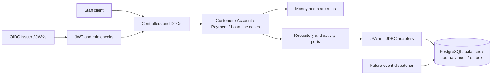

# Banking Platform

A Java 17 / Spring Boot / PostgreSQL staff-operated banking backend. Customer onboarding, accounts, teller deposits and withdrawals, internal transfers, a balanced journal, and principal-only lending are implemented. This repository is a hardened reference system, not an approval to operate a regulated bank.

## Local run

Start Docker Desktop. From the repository root:

```powershell
Copy-Item .env.example .env
# Set LOCAL_DEMO_PASSWORD and POSTGRES_PASSWORD in .env.
docker compose up --build
```

API: http://localhost:8080/api/v1. Swagger: http://localhost:8080/swagger-ui/index.html. Local username: `demo`; password: the LOCAL_DEMO_PASSWORD you configured. The example password is only for local development. Production authentication uses signed JWTs and never registers this demo user.

Run `scripts/demo.ps1 -Password <your-local-password>` or import `docs/banking.postman_collection.json`; set the collection credentials and ID variables. Reuse a fixed Idempotency-Key for retries; the collection generates fresh keys by default.

## Verify

Java 17+ and Maven 3.9+ are required. Select Java 17 using JAVA_HOME if Java 8 is your default.

```powershell
mvn spotless:apply
mvn verify
```

For an isolated PostgreSQL run plus an HTTP banking demo on Windows, use `scripts/verify-postgres.ps1 -PostgresBin 'C:\path\to\pgsql\bin'`; see the testing guide for details.

The default suite uses H2 for fast business, concurrency and API regressions. CI supplies PostgreSQL 17 and runs the same suite plus PostgreSQL-only deferred-balance and immutability tests. H2 does not validate PostgreSQL trigger behavior. See [the testing guide](docs/testing.md) for exact environment variables.

## Design

Packages are organized into controller, service, repository, model, dto, config, filter, exception, domain, audit and infrastructure layers. Constructor-injected adapters implement persistence and audit ports. Domain rules do not depend on HTTP. Entities encapsulate their state; controllers return immutable DTOs. ArchUnit enforces key boundaries and Spotless enforces a common format.

Payment transactions lock accounts in UUID order and refresh cached state under the lock. Balances, posting, two journal entries, actor audit and an outbox record commit together. All monetary values use exact minor units and bounded decimals. Failed transfers roll back the entire operation. PostgreSQL adds deferred journal-balance checks and append-only financial/audit records. Idempotency keys are global within this single-bank deployment, not scoped per tenant. A key collision across unrelated account sets returns 409; retry only the original request.



See [architecture](docs/architecture.md), [ADRs](docs/adr/0001-transactional-modular-monolith.md), [coverage](docs/requirements.md), and [operations](docs/operations.md).

## Account history and statements

Account transaction history, dated statements and CSV downloads are available to OPERATIONS and AUDITOR staff. Statement balances come from posted customer-ledger entries, with repeatable-read consistency and bounded exports. See [API details and the live demo](docs/account-statements.md).

## Production configuration

Use a configured OIDC provider and explicit HTTPS JWT_ISSUER_URI, JWT_JWK_SET_URI and JWT_AUDIENCE. Tokens require a nonempty subject and a roles array. Staff roles: OPERATIONS, COMPLIANCE, TELLER, CREDIT, AUDITOR; MONITORING is restricted to Prometheus scraping. JWT signatures, expiry, issuer and audience are verified. API docs are disabled outside the local profile. Combining `local` and `production` profiles fails startup.

Use an external PostgreSQL database with TLS, a restricted runtime role, separate migration credentials and managed secrets. The production compose file and Kubernetes manifest are templates requiring environment-specific configuration. Run migrations before deploying with automatic migrations disabled. Do not deploy the local compose stack publicly.

## Functional boundaries

This is a staff API for one banking entity. It does not implement customer self-service ownership, multitenancy, maker-checker approval, real KYC/AML/sanctions, interest/fees/amortization, FX, external settlement or regulatory reporting. A teller deposit records a posting; it does not collect external money.

The optional Fineract integration provisions verified clients and savings applications through durable commands, external-ID recovery and endpoint/tenant-scoped mappings. The local ledger remains authoritative. Provisioning does not send financial transactions or activate remote savings accounts. An optional isolated Fineract sandbox can be started and verified with `scripts/start-fineract-sandbox.ps1 -JavaHome <your-JDK-path>`. See [sandbox setup and operation](docs/fineract-setup.md) and [ADR 0003](docs/adr/0003-fineract-provisioning.md) for configuration, the live demo and ledger ownership boundaries. [Live commissioning results](docs/fineract-live-verification.md) cover manual/background provisioning and the PostgreSQL suite.

Outbox records are durable delivery intents. A Kafka/webhook dispatcher and idempotent consumers are not yet implemented; no broker-delivery guarantee is claimed. Audit records are protected from ordinary DML in PostgreSQL, not from a privileged DBA. Archive signed audit exports in a separately controlled store for stronger tamper evidence.

A deployment needs product-specific controls, a supported framework release/support plan, vulnerability and penetration review, load testing, backup restore drills and operational sign-off. See the runbook for the remaining gates.

## Upstream references

- [Spring Security JWT validation](https://docs.spring.io/spring-security/reference/6.5/servlet/oauth2/resource-server/jwt.html)
- [PostgreSQL deferred constraint triggers](https://www.postgresql.org/docs/17/sql-createtrigger.html)
- [Fineract](https://fineract.apache.org/docs/stable/)
